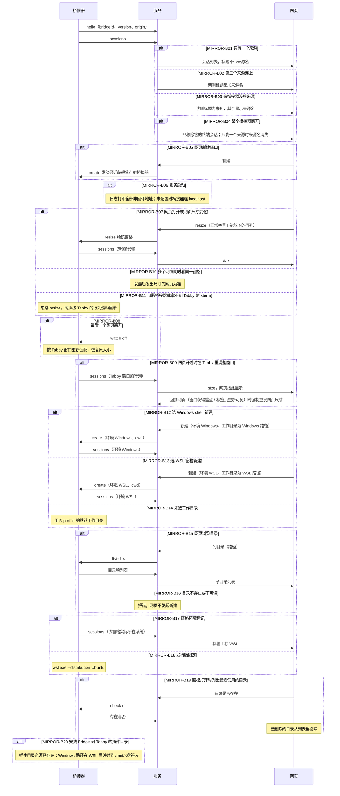

# 终端镜像（MIRROR）

## 概述

桥接器连上服务后，网页列出它的终端会话。只有一个来源时标题不带来源名；第二个来源连上后，两侧标题都加来源名。网页新建窗口开在最近获得焦点的那个桥接器上。服务启动时打印全部非回环地址，供另一侧填进配置。有网页在看某个窗格时，窗格按网页的大小排版（网页用正常字号铺满）；最后一个网页离开后，尺寸交还给 Tabby。

## 时序图

## 分支表

| ID | 分支 | 状态 | 代码位置 | 测试 | 终态 / 下一步 | 不变量 | 确认方 |
|---|---|---|---|---|---|---|---|
| MIRROR-B01 | 只有一个来源连着 | done | src/session-hub.js:218 | test/session-hub.test.js::MIRROR-B01 | 网页列出它的终端会话，标题不带来源名 | 一个来源时标题与现在一致 | user |
| MIRROR-B02 | 第二个来源连上 | done | src/session-hub.js:218 | test/session-hub.test.js::MIRROR-B02 | 两侧标题都加来源名 | 来源名来自桥接器上报的系统，不是窗口号 | user |
| MIRROR-B03 | 多个来源里有桥接器没报来源 | done | src/session-hub.js:7 | test/session-hub.test.js::MIRROR-B03 | 该侧标题为未知 | 不用窗口号冒充来源 | user |
| MIRROR-B04 | 某个桥接器断开 | done | src/session-hub.js:104 | test/session-hub.test.js::MIRROR-B04 | 只移除它的终端会话；只剩一个来源时来源名消失 | 不影响另一个桥接器的终端会话 | user |
| MIRROR-B05 | 网页新建窗口 | done | src/session-hub.js:326 | test/session-hub.test.js::MIRROR-B05 | 新标签开在最近获得焦点的桥接器上 | 不新增选择来源的操作 | user |
| MIRROR-B06 | 服务在 WSL 启动 | done | src/server.js:16 | test/server.test.js::MIRROR-B06 | 日志里有全部非回环地址 | 找不到地址或未配置时，桥接器仍连 localhost | user |
| MIRROR-B07 | 网页打开或网页尺寸变化 | done | public/app.js:355, public/app.js:276, bridge/src/bridge-core.js:234, bridge/src/bridge-core.js:480 | test/app.test.js::MIRROR-B07 | 窗格改为稳定可见区对应的行列，网页铺满 | 网页字号不变；新尺寸先于该尺寸下的输出到达网页；备选屏幕快照裁剪到当前列宽 | user |
| MIRROR-B08 | 最后一个网页离开该窗格 | done | bridge/src/bridge-core.js:445 | test/bridge-core.test.js::MIRROR-B08 | 窗格按 Tabby 窗口重新适配，恢复原大小 | 没有网页在看时，尺寸归 Tabby；短时刷新不误触发交还 | user |
| MIRROR-B09 | 网页开着时在 Tabby 里用过窗格 | done | public/app.js:437, public/app.js:734 | test/app.test.js::MIRROR-B09 | 在 Tabby 时以 Tabby 为准，网页按新行列显示；回到网页时窗格改回网页尺寸 | 网页不在收到 Tabby 的尺寸后立刻抢回；回到网页无需手动操作即恢复铺满 | user |
| MIRROR-B10 | 多个网页同时看同一窗格 | done | src/session-hub.js:250 | test/session-hub.test.js::MIRROR-B10 | 以最后发出尺寸的网页为准 | 每个窗格同一时刻只有一个尺寸 | user |
| MIRROR-B11 | 旧版桥接器或拿不到 Tabby 的 xterm | done | bridge/src/bridge-core.js:412 | test/bridge-core.test.js::MIRROR-B11 | 忽略 resize，网页按 Tabby 的行列滚动显示 | 不因改尺寸失败而断开或报错 | user |
| MIRROR-B12 | 选 Windows shell 新建 | done | src/session-hub.js:344, bridge/src/index.js:77 | test/session-hub.test.js::MIRROR-B12 | 起 Windows shell 窗格，工作目录为所选 Windows 路径 | 不因目录选择而改变 Tabby 其它 profile | user |
| MIRROR-B13 | 选 WSL 窗格新建 | done | src/session-hub.js:344, bridge/src/index.js:77 | test/session-hub.test.js::MIRROR-B13 | 起 wsl.exe 窗格，工作目录为所选 WSL 路径（Linux 形式） | Windows 路径不会被当作 WSL 路径传入 | user |
| MIRROR-B14 | 新建时未选工作目录 | done | src/session-hub.js:344, bridge/src/index.js:77 | test/app.test.js::MIRROR-B14 | 用该 profile 的默认工作目录 | 不传 cwd 时不覆盖 Tabby 默认值 | user |
| MIRROR-B15 | 网页逐级浏览目录 | done | src/session-hub.js:366, bridge/src/directories.js:47, public/app.js:641 | test/bridge-paths.test.js::MIRROR-B15 | 返回该目录的子目录列表，目录在前文件在后，各按名称不区分大小写排序 | 显示隐藏项；WSL 路径经 UNC 读取 | user |
| MIRROR-B16 | 目录不存在或不可读 | done | bridge/src/directories.js:47, public/app.js:641 | test/bridge-paths.test.js::MIRROR-B16 | 报错，网页不发起新建 | 目录错误不产生半开的窗格 | user |
| MIRROR-B17 | 窗格环境标记 | done | bridge/src/index.js:20, public/app.js:543 | test/bridge-core.test.js::MIRROR-B17 | WSL 窗格标签标 WSL，Windows shell 不标 | 与「来源」（桥接器所在系统）是两个独立概念 | user |
| MIRROR-B18 | WSL 发行版固定 | done | bridge/src/index.js:77 | test/bridge-core.test.js::MIRROR-B13 | 始终使用 Ubuntu 发行版 | 发行版不随网页选择而变 | user |
| MIRROR-B19 | 新建面板记住最近使用的目录 | done | public/app.js:620, public/app.js:643, src/session-hub.js:377 | test/app.test.js::MIRROR-B19 | 按环境分别记住最近 6 个目录，在工作目录旁列出，点一下即选中 | 两边的路径不混用；已删除的目录在下次打开面板时剔除 | user |
| MIRROR-B20 | 安装 Bridge 到 Tabby 的插件目录 | done | bridge/scripts/install.mjs | test/install.test.js::MIRROR-B20 | 复制到 Tabby 所在系统的插件目录；目录不存在时报错退出 | Windows 路径在 WSL 里映射到 /mnt/<盘符>/，不会落到当前目录 | user |

> "确认方"：分支改为 `done` 时填写。用户访谈确认写 `user`；模型按决策归属自行确认写 `model:<事实依据>`。`finish` 会列出模型自行确认的分支供复核。

## 关联流程（边界分支）

| 方向 | 流程 | 边界分支 | 说明 |
|---|---|---|---|
| — | — | — | 本次只有这一个流程 |

## 待确认问题 / 待决策

无。2026-11-14 访谈已确认：一份服务、来源按系统自动上报、多来源才显示、缺来源显示未知、新建窗口跟最近焦点、窗口必须可见、启动时打印全部非回环地址、找不到则退回 localhost。

2026-11-14 第二轮确认：网页铺满且适配手机，网页开着时窗格按网页尺寸（MIRROR-B07～B11），网页字号保持正常；用户已知网页开着期间 Tabby 窗口里该窗格会错位。

## 变更记录

| 日期 | 任务 | 变更的分支 ID |
|---|---|---|
| 2026-11-14 | 登记 WSL 与 Windows 两侧镜像 | MIRROR-B01, MIRROR-B02, MIRROR-B03, MIRROR-B04, MIRROR-B05, MIRROR-B06 |
| 2026-11-14 | 改用 Windows Tabby 承载 WSL 窗格（不再部署 WSL 里的 Linux 版 Tabby）；实机验证 MIRROR-B01：Windows Bridge 同时上报 WSL 与 CMD 窗格，网页双向输入输出正常。代码与分支无变化 | MIRROR-B01 |
| 2026-11-14 | 网页开着时窗格按网页尺寸，网页正常字号铺满并适配手机；全屏不再放大字号 | MIRROR-B07, MIRROR-B08, MIRROR-B09, MIRROR-B10, MIRROR-B11 |
| 2026-11-14 | 修复：从 Tabby 切回网页后网页不再铺满（尺寸去重挡住了重发），回到网页时强制重发 | MIRROR-B09 |
| 2026-11-14 | 修复：刷新网页时 Bridge 延迟交还尺寸并取消待定 Tabby refit 竞态；网页量取 #terminal-wrapper 避开临时滚动条，监听 ResizeObserver、补充手机输入法收尾对齐并允许新尺寸覆盖在途旧尺寸 | MIRROR-B07, MIRROR-B08 |
| 2026-11-14 | 修复：切回网页后画面被旧尺寸截断/折行（Tabby 的 terminal.size 经 auditTime(100) 滞后于 xterm.resize，Bridge 改读 frontend.xterm 实时尺寸、订阅 resize$ 并在输出前同步尺寸） | MIRROR-B07, MIRROR-B09 |
| 2026-11-14 | 修复：手机端打开/刷新缩小后的窗格时画面错乱（xterm 缩列不缩 BufferLine 长度，SerializeAddon 吐出 311 列旧宽残影导致在 49 列手机屏 7 倍折行），Bridge 在序列化备选屏幕时按当前 cols 裁剪行宽 | MIRROR-B07 |
| 2026-11-14 | 新建终端时可选环境（Windows shell / WSL 窗格）与工作目录，网页提供逐级目录浏览；窗格标签增加环境标记 | MIRROR-B12, MIRROR-B13, MIRROR-B14, MIRROR-B15, MIRROR-B16, MIRROR-B17, MIRROR-B18 |
| 2026-11-14 | 新建面板在工作目录旁维护最近使用目录，按环境分组；已删除的目录在打开面板时剔除 | MIRROR-B19 |
